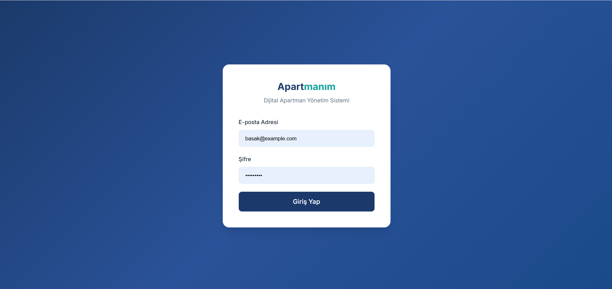
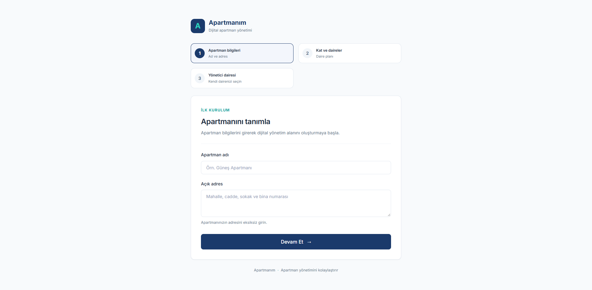
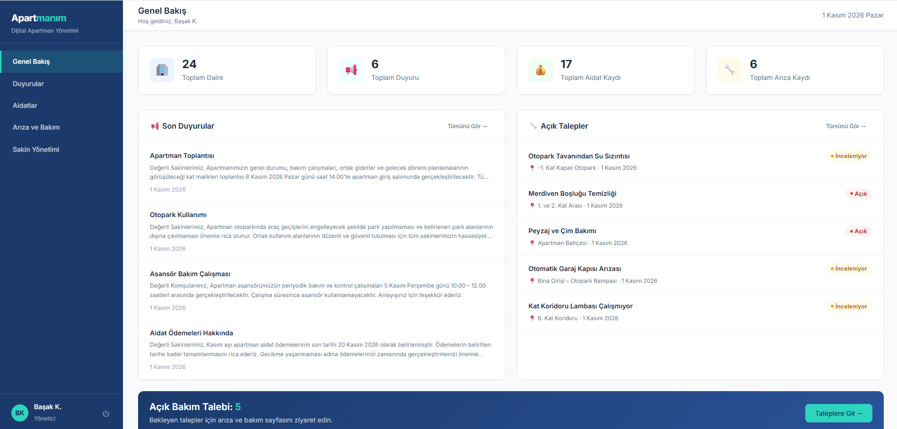
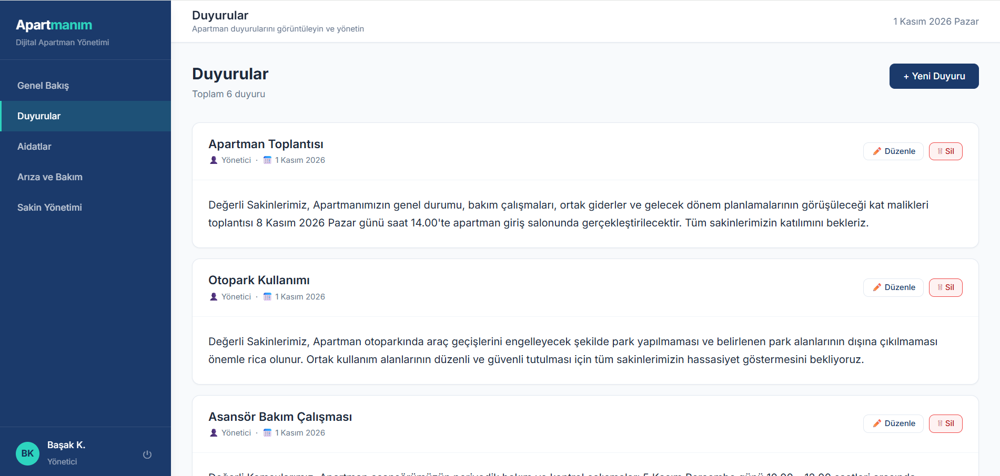
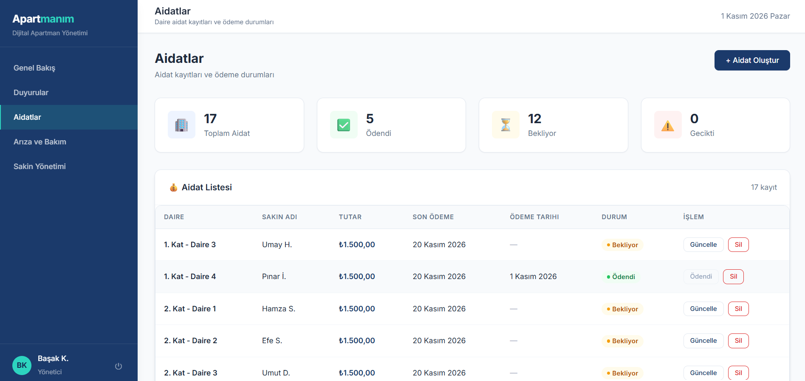
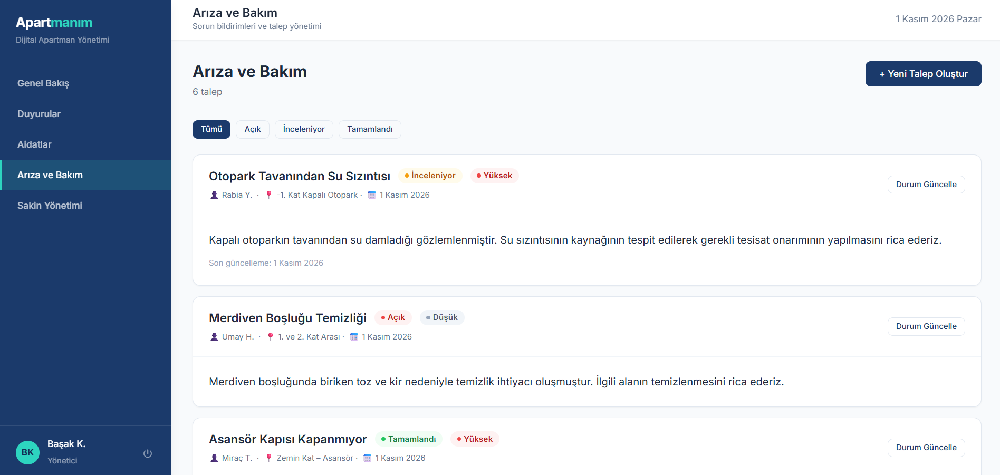
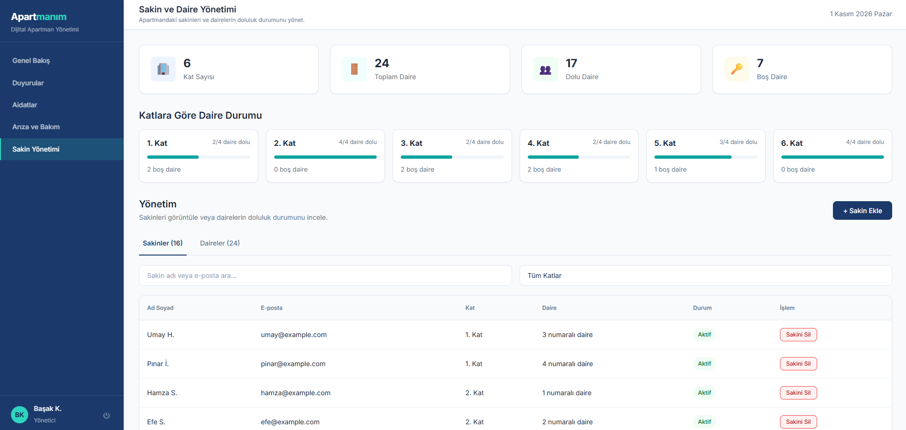
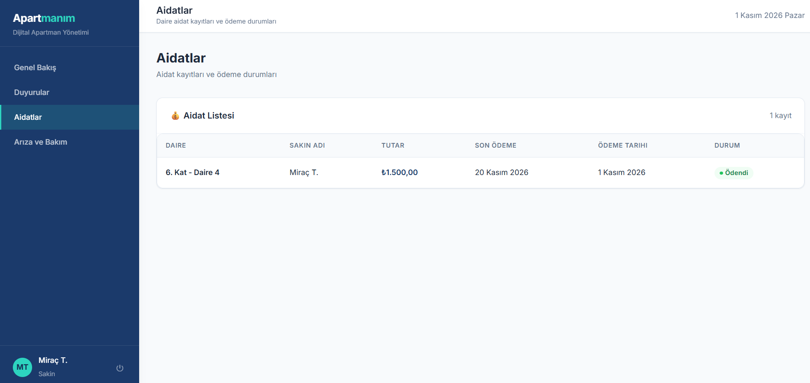

 <h1 align="center">🏢 Apartmanım – Dijital Apartman Yönetim Sistemi</h1>

  Apartman yönetim süreçlerini dijital ortamda kolaylaştırmak için geliştirilmiş web uygulaması.

  <strong>React · TypeScript · ASP.NET Core Web API · C# · Entity Framework Core · PostgreSQL</strong>

<h2>📌 Proje Hakkında</h2>

  Apartmanım, apartman yönetim süreçlerini tek bir platform üzerinden dijitalleştirmek amacıyla geliştirilmiş bir web uygulamasıdır. Apartman yöneticilerinin ve sakinlerinin duyuru, aidat ve bakım-onarım taleplerini kolayca takip edebilmesini sağlar.

  Uygulama, Yönetici (Admin) ve Apartman Sakini (Resident) olmak üzere iki farklı kullanıcı rolüne sahiptir. Her kullanıcı, rolüne uygun yetkiler doğrultusunda uygulamanın ilgili bölümlerine erişebilir.

<h2>🚀 Kullanılan Teknolojiler</h2>

<h3>Frontend</h3>
<ul>
  <li>React</li>
  <li>TypeScript</li>
  <li>React Router</li>
  <li>Context API</li>
  <li>Axios</li>
  <li>React Hook Form</li>
</ul>

<h3>Backend</h3>
<ul>
  <li>C#</li>
  <li>ASP.NET Core Web API (.NET 10)</li>
  <li>Entity Framework Core</li>
  <li>JWT Authentication</li>
</ul>

<h3>Veritabanı</h3>
<ul>
  <li>PostgreSQL</li>
</ul>

<h2>✨ Özellikler</h2>

<h3>🔐 Kimlik Doğrulama ve Yetkilendirme</h3>
<ul>
  <li>E-posta ve şifre ile giriş yapabilme.</li>
  <li>JWT tabanlı kimlik doğrulama.</li>
  <li>Yönetici ve apartman sakini için rol bazlı yetkilendirme.</li>
  <li>Kullanıcıların yalnızca yetkili oldukları sayfalara erişebilmesi.</li>
  <li>İlk girişte geçici şifre kullanan sakinlerin şifre değiştirmesinin zorunlu tutulması.</li>
</ul>

<h3>🏢 Apartman Yönetimi</h3>
<ul>
  <li>Yönetici tarafından apartman oluşturulabilmesi.</li>
  <li>Kat ve daire bilgilerinin tanımlanabilmesi.</li>
  <li>Apartman ve daire bilgilerinin yönetilebilmesi.</li>
  <li>Yönetici ve sakinlerin dairelerle ilişkilendirilmesi.</li>
</ul>

<h3>👥 Sakin Yönetimi</h3>
<ul>
  <li>Yönetici tarafından apartman sakinlerinin sisteme eklenebilmesi.</li>
  <li>Sakinlerin dairelerle eşleştirilmesi.</li>
  <li>Sakin bilgilerinin görüntülenebilmesi.</li>
  <li>Sakinlerin sistemden kaldırılabilmesi.</li>
</ul>

<h3>📢 Duyuru Yönetimi</h3>
<ul>
  <li>Yönetici tarafından duyuru oluşturulabilmesi.</li>
  <li>Apartman sakinlerinin duyuruları görüntüleyebilmesi.</li>
  <li>Duyuruların tarih bilgileriyle birlikte listelenmesi.</li>
</ul>

<h3>💰 Aidat Yönetimi</h3>
<ul>
  <li>Yönetici tarafından dairelere aidat kaydı oluşturulabilmesi.</li>
  <li>Tek bir daireye veya birden fazla daireye aidat tanımlanabilmesi.</li>
  <li>Aidat tutarı ve son ödeme tarihinin belirlenebilmesi.</li>
  <li>Ödenen, bekleyen ve gecikmiş aidatların takip edilebilmesi.</li>
  <li>Yönetici tarafından aidat ödeme durumunun güncellenebilmesi.</li>
  <li>Aidat kayıtlarının silinebilmesi.</li>
  <li>Toplam aidat, ödenen tutar ve bekleyen tutar gibi özet bilgilerin görüntülenebilmesi.</li>
  <li>Sakinlerin kendi dairelerine ait aidat bilgilerini görüntüleyebilmesi.</li>
</ul>

<h3>🛠️ Bakım ve Arıza Talepleri</h3>
<ul>
  <li>Apartman sakinlerinin bakım ve arıza talebi oluşturabilmesi.</li>
  <li>Taleplere başlık, açıklama, konum ve öncelik bilgisi eklenebilmesi.</li>
  <li>Taleplerin durum ve öncelik bilgileriyle listelenmesi.</li>
  <li>Apartman sakinlerinin aynı apartmanda oluşturulan talepleri görüntüleyebilmesi.</li>
  <li>Taleplerin hangi sakin tarafından oluşturulduğunun görüntülenebilmesi.</li>
  <li>Yöneticinin talep durumunu güncelleyebilmesi.</li>
</ul>

<h3>📊 Dashboard</h3>
<ul>
  <li>Kullanıcı rolüne göre farklı özet bilgilerin görüntülenmesi.</li>
  <li>Apartman duyurularının listelenmesi.</li>
  <li>Bakım ve arıza taleplerinin takip edilmesi.</li>
  <li>Aidat ve daire bilgilerinin özet olarak görüntülenmesi.</li>
</ul>

<h2>👤 Kullanıcı Rolleri</h2>

<table>
  <thead>
    <tr>
      <th>Özellik</th>
      <th>Yönetici</th>
      <th>Apartman Sakini</th>
    </tr>
  </thead>
  <tbody>
    <tr><td>Giriş yapma</td><td>✓</td><td>✓</td></tr>
    <tr><td>Dashboard görüntüleme</td><td>✓</td><td>✓</td></tr>
    <tr><td>Apartman ve daire yönetimi</td><td>✓</td><td>-</td></tr>
    <tr><td>Sakin ekleme ve yönetme</td><td>✓</td><td>-</td></tr>
    <tr><td>Duyuru oluşturma</td><td>✓</td><td>-</td></tr>
    <tr><td>Duyuruları görüntüleme</td><td>✓</td><td>✓</td></tr>
    <tr><td>Aidat oluşturma</td><td>✓</td><td>-</td></tr>
    <tr><td>Aidat durumunu güncelleme</td><td>✓</td><td>-</td></tr>
    <tr><td>Aidat bilgilerini görüntüleme</td><td>✓</td><td>✓</td></tr>
    <tr><td>Bakım ve arıza talebi oluşturma</td><td>✓</td><td>✓</td></tr>
    <tr><td>Apartmandaki talepleri görüntüleme</td><td>✓</td><td>✓</td></tr>
    <tr><td>Talep durumunu güncelleme</td><td>✓</td><td>-</td></tr>
  </tbody>
</table>

## 📸 Uygulama Ekran Görüntüleri

  
  

  
  

  
  

  
  

<h2>🔒 Güvenlik</h2>

<ul>
  <li>Kimlik doğrulama JWT üzerinden gerçekleştirilir.</li>
  <li>API uç noktalarında rol bazlı erişim kontrolü uygulanır.</li>
  <li>Yönetici işlemleri ilgili apartmanla sınırlandırılır.</li>
  <li>Sakinler kendi aidat kayıtlarını görüntüler.</li>
  <li>Kullanıcıların yetkisiz işlemlere erişmesi engellenir.</li>
</ul>

<h2>🎯 Projenin Amacı</h2>

  Apartmanım, apartman yönetiminde sık karşılaşılan temel ihtiyaçları tek bir uygulamada bir araya getirmeyi hedefleyen bir portföy projesidir.

  Projenin geliştirilme sürecinde frontend ve backend entegrasyonu, REST API kullanımı, JWT tabanlı kimlik doğrulama, rol bazlı yetkilendirme, Entity Framework Core ve PostgreSQL ile veritabanı işlemleri üzerine çalışılmıştır.

  <strong>Apartmanım – Dijital Apartman Yönetim Sistemi</strong>

